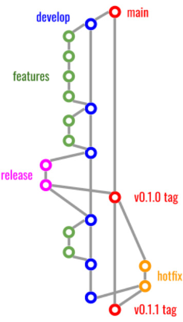
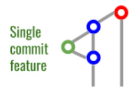
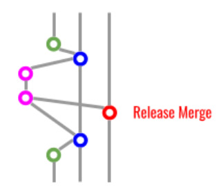
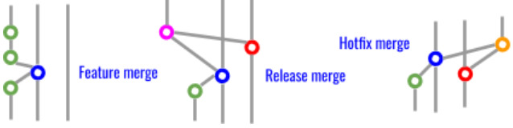

# Git Workflow

This project follows GitFlow. Two branches live forever: `main` (always production-ready, every commit on it is a tagged release) and `develop` (the integration branch, where finished feature work lands before a release). Three kinds of short-lived branches build on top of them: `feature/*`, `release/*`, and `hotfix/*`. Every merge into `main` or `develop` uses `--no-ff`; neither branch ever takes a direct commit or a fast-forward merge, so the branch structure itself stays visible in the history instead of getting flattened away.



## Table of Contents

- [Git Workflow](#git-workflow)
  - [Table of Contents](#table-of-contents)
  - [Feature branches](#feature-branches)
  - [Release branches](#release-branches)
  - [Hotfix branches](#hotfix-branches)
  - [Tagging convention](#tagging-convention)

## Feature branches

Branch from `develop`, named `feature/<short-description>` (e.g. `feature/add-exoneraciones-support`). Do the work, commit as usual, then merge back into `develop`:

```
# always from develop
git checkout -b feature/add-thing
# ...commit your work...
git checkout develop
git merge --no-ff feature/add-thing
git push origin develop
```



## Release branches

Cut from `develop` once it has everything the next release needs, named `release/vX.Y.Z`. Only last-mile changes belong on it: the version bump itself (`VERSION`, `CHANGELOG.md`, etc), and any fix found while stabilizing that release. It merges into both `main` (tagged with the version) and back into `develop`, so develop never falls behind what actually shipped:

```
# always from develop
git checkout -b release/vX.Y.Z

# Bump the version: VERSION, CHANGELOG.md.
git add VERSION CHANGELOG.md
git commit -m "Bump version"

git checkout main
git merge --no-ff release/vX.Y.Z
git tag -a vX.Y.Z
```

See [Tagging convention](#tagging-convention) below for the message that command opens your editor for, then:

```
git checkout develop
git merge --no-ff release/vX.Y.Z

git push origin main develop
git push origin vX.Y.Z
```



## Hotfix branches

For an urgent fix to what's already running in production. Branches from `main` (not `develop`), named `hotfix/X.Y.Z`. Same shape as a release branch otherwise: it bumps the version (a patch bump), merges into `main` (tagged), and also merges into `develop` so the fix isn't silently lost on the next regular release:

```
git checkout -b hotfix/X.Y.Z main

# Fix the bug, then bump VERSION/CHANGELOG.md same as a release does, and commit.

git checkout main
git merge --no-ff hotfix/X.Y.Z
git tag -a vX.Y.Z
```

Same tag template as a release, see [Tagging convention](#tagging-convention) below, then:

```
git checkout develop
git merge --no-ff hotfix/X.Y.Z

git push origin main develop
git push origin vX.Y.Z
```

A hotfix merge has the same shape as a release merge above, just branching from (and tagging) `main` directly instead of `develop`. Side by side, the three kinds of merge this project uses:



## Tagging convention

`git tag -a vX.Y.Z`, with no `-m`, opens your editor for the message instead of cramming it onto the command line. The message follows one template:

```
Release vX.Y.Z includes:

    * Headline change one
    * Headline change two
```

(`Hotfix vX.Y.Z includes:` instead, for a hotfix tag.) Each bullet mirrors one headline from that version's own new `CHANGELOG.md` entry, one line each.
